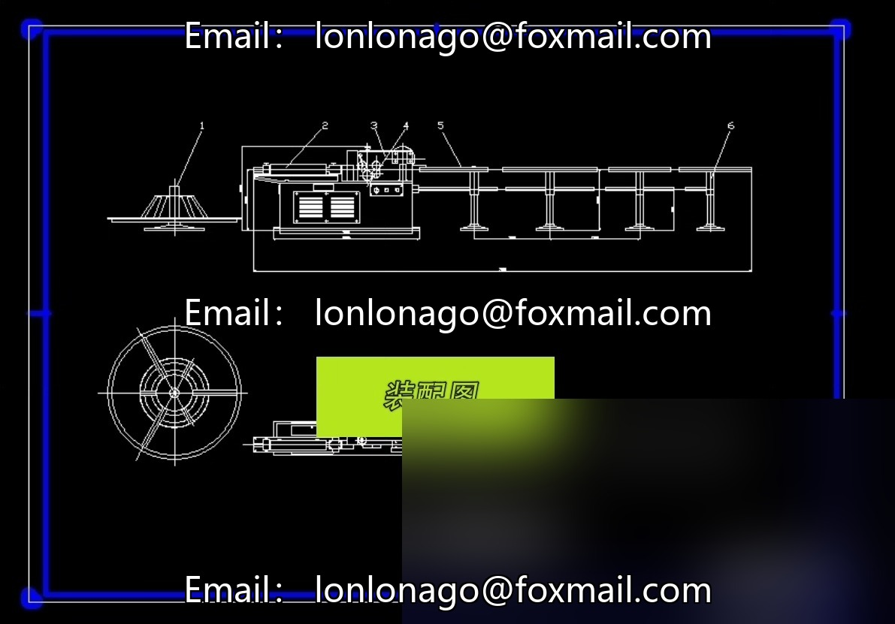

# Steel wire straightening machine design, steel wire straightening machine figure, steel wire straightening machine design figure, steel wire straightening machine design figure

## Body

Rivetstraightening machine design; Rivetstraightening machine drawing; Rivetstraightening machine design drawing; Rivetstraightening machine design CAD drawing
148 The constructed rivet straightening machine in this design is a rivet straightening machine, which adopts a cut knife material cutting straight-cut method. This machine has a simple structure, unique appearance, low noise, small power loss, high efficiency, accurate rivet straightening, wide straightening range, safe and reliable operation, especially reducing the labor intensity of workers.

The drawings include the assembly net, CAD drawings for the rebar straightening machine, and design-related figures, reflecting a knife-cut material-removal straightening shear method and its product design.

<!-- AI_ENRICHED -->

## Images

## Payment

Here is a pay link on Stripe ( https://buy.stripe.com/3cs8yP7sY87d0vu9AB ). Please contact me lonlonago@foxmail.com after funding $89, and I will send you a complete data files , thank you!

